# devsweep

Scan your dev setup and repos for the supply-chain and credential risks that infostealers exploit.

> **Status:** early development (0.x). Workflow and repository-settings checks work, with SARIF output (the report format GitHub's Security tab reads) and a GitHub Action. Dependency and secret checks are next.



**Why care?** Attackers often skip your code and go after something your project trusts: a GitHub Action you use, your release workflow, or a maintainer's access token. That's a _supply-chain attack_. One common way tokens get stolen is _infostealers_: malware that copies saved passwords and tokens off developers' computers. devsweep finds the settings that would let a stolen token or a hijacked action do real damage, and tells you how to fix each one.

Today it checks:

- **GitHub Actions workflows** (the `.github/workflows/*.yml` files): for example, actions that could be swapped for different code, workflows that run strangers' pull request code with your secrets, and tokens with more access than they need.
- **The repository's settings on GitHub**: whether the default branch and release tags can be force-pushed (overwritten), and whether someone did so recently.

Run it on your own machine, or in CI (continuous integration: the checks that run automatically on every push) as a [GitHub Action](#github-action).

## Quickstart

You need [Node.js](https://nodejs.org) 22.12 or later. In the root folder of a repository you want to check, run:

```sh
npx @frank1738/devsweep
```

`npx` downloads devsweep and runs it without installing it for good. The first time, it asks `Ok to proceed? (y)`: type `y`. To scan a different folder, put its path after the name: `npx @frank1738/devsweep path/to/repo`.

If you'll use it often, install it once and then run it as `devsweep`:

```sh
npm install -g @frank1738/devsweep
devsweep
```

To list every option, run `npx @frank1738/devsweep scan --help` (or `devsweep scan --help`). Keep the word `scan` in there: for now, `--help` on its own doesn't show the options. [Usage](#usage) has the details.

### Reading the output

This is devsweep scanning `test/fixtures/vulnerable-repo`, a sample repository in this project with problems planted on purpose (with `--offline`, which is explained below):

```text
  devsweep  test/fixtures/vulnerable-repo

  .github/workflows/pr-preview.yml
    ● critical  14  Runs pull request code with secrets   job preview
    ● high      16  Unpinned action                       example-org/deploy-preview@v2
    ● medium     9  Token permissions not limited         job preview

  .github/workflows/release.yml
    ● high       7  Token can write to everything         whole workflow
    ● high      11  Unpinned action                       example-org/shared-workflows/.github/workflows/build.yml@main
    ● high      17  Unpinned action                       docker://alpine:3.20
    ● high      18  Unpinned action                       example-org/create-release@v2
    ● high      22  Force push                            tag v1

  .github/workflows/label.yml
    ● medium     3  Uses the pull_request_target trigger

  .github/workflows/docs.yml
    ● low       16  Force push                            branch gh-pages

  10 issues  1 critical  6 high  2 medium  1 low  · 13 ms
  Add --details to see why each one matters and how to fix it.
```

Findings are grouped by file. Each line is one finding: its **severity** (critical, high, medium or low), the **line** in the file, **what's wrong**, and **what it's about**, such as a job, an action or a branch. The last lines count the findings by severity and say how long the scan took (that time changes from run to run).

You may also see lines that this example doesn't have:

- Findings about the repository's settings on GitHub (the `repo/*` rules) aren't in any file. They're listed under **GitHub repository settings**, with no line number.
- A line that starts with `!` is a warning, not a finding. For example, a workflow file devsweep skipped because it isn't valid YAML. A line that starts with `×` means a check crashed, so the results are incomplete.

Add `--details` (or `-d`) to see, for each finding, why it's a risk, the lines of code involved, how to fix it, and the ID of the rule that found it. Here are the first two findings from the same scan:


New to words like _pinned_ and _commit SHA_? They're explained under [What it checks](#what-it-checks).

Two more things you'll notice:

- When devsweep finds anything, it ends with exit code 1. An _exit code_ is the number a program hands back when it finishes, and CI treats anything other than 0 as a failure. So a CI job that runs devsweep fails until the findings are fixed or [accepted](#accepting-reviewed-findings). [Exit codes](#exit-codes) explains how to change this.
- You may see a warning such as "Couldn't check GitHub repository settings for owner/repo: no token". That's not a finding. Those checks need a GitHub token ([how to give it one](#github-repository-checks)). Pass `--offline` to skip them.

### What you're installing

The npm package has no dependencies. devsweep and the three libraries it uses (commander, picocolors and yaml) are bundled into plain JavaScript files. They aren't minified, so you can read exactly what runs.

Every release is built by GitHub Actions and published with [provenance](https://docs.npmjs.com/generating-provenance-statements): a signed record, stored with the package on npm, of the repository, commit and workflow that built it. In a project that has devsweep installed, `npm audit signatures` checks that record. [Releases](#releases) describes the whole process.

## Usage

Here's the whole flow at a glance: what devsweep reads, and what it gives back. The rest of this section covers each part.


```sh
npx @frank1738/devsweep [path] [options]
```

`path` is the folder to scan. It defaults to the current one. After a global install, use `devsweep [path] [options]` instead. The options are:

```sh
npx @frank1738/devsweep [path] --details        # explain each finding, with the code and the fix (short form: -d)
npx @frank1738/devsweep [path] --json           # machine-readable output, for scripts
npx @frank1738/devsweep [path] --sarif          # SARIF 2.1.0, the format GitHub's Security tab reads
npx @frank1738/devsweep [path] --sarif -o FILE  # save the report to FILE, and show the readable one
npx @frank1738/devsweep [path] --fail-on high   # fail only on high or critical findings
npx @frank1738/devsweep [path] --offline        # skip the checks that call the GitHub API
npx @frank1738/devsweep [path] --no-color       # turn off colors
```

To see every option, run `npx @frank1738/devsweep scan --help`. Include `scan`: for now, `--help` on its own lists only the `scan` command, not its options. `scan` is the default command, so you can leave it out everywhere else. `--version` prints the version.

- `--json` and `--sarif` can't be used together. Either one prints its report instead of the readable one, unless you also pass `-o`.
- `-o`/`--output` works only with `--json` or `--sarif`. It creates missing folders, and the terminal (or CI log) still shows the readable report.
- In a terminal window that's wide enough, devsweep opens with a gradient banner that sweeps in, and shows a sweep line if the scan takes a moment. In CI, or when output is piped, the output is plain text with no animation. `--no-color` or the `NO_COLOR` environment variable turns colors off anywhere.

### Exit codes

An _exit code_ is the number a program returns when it finishes. CI systems such as GitHub Actions treat 0 as success and anything else as failure, so devsweep's exit code decides whether your job passes. devsweep uses three:

| Code | Meaning                                                                                                                                          |
| ---- | ------------------------------------------------------------------------------------------------------------------------------------------------ |
| 0    | Nothing found at or above the `--fail-on` severity                                                                                               |
| 1    | Findings at or above the `--fail-on` severity                                                                                                    |
| 2    | devsweep couldn't do its job: a bad option, a path that can't be scanned, a broken config file, a report that can't be saved, or a check crashed |

`--fail-on` sets the lowest severity that fails the run: `critical`, `high`, `medium`, `low` or `none`. The default is `low`, so any finding fails the run. For example, with `--fail-on high`, a scan that finds only medium and low issues exits with 0, and one that finds a high or critical issue exits with 1. `none` never fails on findings.

A crashed check gives 2 even when there are findings, because the results are incomplete. Warnings, such as files skipped as invalid YAML or "couldn't check" messages, are listed but don't change the exit code.

### Accepting reviewed findings

Sometimes a finding is fine for your project. When you've reviewed one and decided to keep it, record that in a `devsweep.config.json` file in the folder you scan. The same file can also change a rule's severity:

```json
{
  "accept": [
    {
      "rule": "workflow/pull-request-target",
      "file": ".github/workflows/label.yml",
      "reason": "Only adds labels; it never checks out or runs pull request code."
    },
    {
      "rule": "workflow/unpinned-action",
      "file": ".github/workflows/ci.yml",
      "subject": "example-org/setup-tool@v3",
      "reason": "Our own action, released from a protected tag."
    }
  ],
  "rules": {
    "workflow/missing-permissions": { "severity": "low" }
  }
}
```

[`test/fixtures/configured-repo`](test/fixtures/configured-repo) has a working example. It also has one acceptance that matches nothing, so you can see the warning that produces.

- An acceptance matches on `rule`, `file` and `subject`, never on line numbers, which move.
- `file` is the path from the folder you scan, with forward slashes, as devsweep prints it.
- `subject` is the text at the end of the finding's line in the readable output, such as `example-org/setup-tool@v3`. A narrow terminal can shorten it with `…`, so run with `--json` to see it exactly. Leave `subject` out only for findings that have none, such as `workflow/pull-request-target` (the first example above).
- Findings about repository settings (the `repo/*` rules) aren't in any file, so leave `file` out for them. For example: `{ "rule": "repo/force-push-detected", "subject": "branch main 1a2b3c4..5d6e7f8", "reason": "History cleanup by a maintainer; we checked the diff." }`
- Every acceptance needs a `reason`. Accepted findings drop out of the list and don't fail the run, but the summary counts them (`2 accepted`).
- An acceptance that no longer matches anything shows up as a warning, so stale exceptions get cleaned up. devsweep skips that warning when it couldn't have seen the finding: when the rule's check was skipped (such as `repo/*` rules with `--offline`), crashed, or couldn't finish (such as a "couldn't check" warning, or a workflow file skipped as invalid YAML).
- `rules` changes a rule's severity. That affects `--fail-on` and every output format.
- Mistakes such as invalid JSON, an unknown rule, an unknown key or a missing reason stop the scan with exit code 2 and a message naming the problem.

In SARIF, accepted findings are kept with a `suppressions` entry that carries the reason. GitHub code scanning doesn't act on suppressions, so they still appear as open alerts there. Dismiss them in the Security tab with the same reason.

Treat this file like code: it switches checks off. A [`CODEOWNERS`](https://docs.github.com/en/repositories/managing-your-repositorys-settings-and-features/customizing-your-repository/about-code-owners) entry for it makes sure every new exception gets reviewed.

## What it checks

devsweep has eight rules. Every finding names its rule ID, which is also what you write in `devsweep.config.json`. The severity shown is the default, and the config file can change it.

| Rule                             | Severity            | Flags                                                                                                                                                                                                                                                                                                   |
| -------------------------------- | ------------------- | ------------------------------------------------------------------------------------------------------------------------------------------------------------------------------------------------------------------------------------------------------------------------------------------------------- |
| `workflow/untrusted-checkout`    | critical            | A `pull_request_target` workflow that checks out or fetches the pull request's code                                                                                                                                                                                                                     |
| `workflow/unpinned-action`       | high                | A third-party action, reusable workflow or `docker://` container image that isn't pinned to a full commit SHA or image digest                                                                                                                                                                           |
| `workflow/write-all-permissions` | high                | `permissions: write-all` at workflow or job level                                                                                                                                                                                                                                                       |
| `workflow/pull-request-target`   | medium              | A `pull_request_target` trigger, which runs with secrets and a write token. Reported only when nothing in the workflow checks out the pull request's code; otherwise `untrusted-checkout` is reported instead                                                                                           |
| `workflow/missing-permissions`   | medium              | No top-level `permissions:`, and jobs that don't set their own                                                                                                                                                                                                                                          |
| `workflow/force-push`            | high, medium or low | A workflow that force-pushes, with `git push --force` (or `-f`, `--force-with-lease`, `--mirror`, a `+` refspec) or an action input such as `force: true`. High for `main`, `master`, tags, every branch at once and mirrors; medium for other branches, or when no branch is named; low for `gh-pages` |
| `repo/force-push-allowed`        | high                | The default branch or release tags aren't protected against force pushes or being moved (read from rulesets, and for the default branch also from classic branch protection)                                                                                                                            |
| `repo/force-push-detected`       | high                | A force push to the default branch in the last 90 days (read from the repository's activity log)                                                                                                                                                                                                        |

Dependency and secret checks are coming next.

Some terms from the table:

- **Pinning** an action means referring to it by a full 40-character commit SHA (the unique ID of a commit) instead of a tag like `v2`. The action's owner, or anyone who takes over their account, can move a tag to different code at any time. A SHA always means the same code. Keep the version in a comment so people can still read it:

  ```yaml
  - uses: example-org/deploy@v2                   # flagged: the tag can move
  - uses: example-org/deploy@<40-character-sha>   # v2.1.0, not flagged
  ```

  Actions owned by GitHub (`actions/…` and `github/…`) aren't flagged.

- **`GITHUB_TOKEN`** is the temporary token GitHub Actions gives each workflow run, so its steps can call GitHub to push code, comment on pull requests and so on. A workflow's `permissions:` key limits what it can do.
- **`pull_request_target`** is a workflow trigger that runs for pull requests, including ones from forks, but with the base repository's secrets and a token that can write.
- A **force push** replaces history on a branch or moves a tag, instead of adding new commits on top.

### GitHub repository checks

The `repo/*` rules read the repository's settings through the GitHub REST API. They are devsweep's only network calls, and `--offline` skips them.

- **Which repository:** the `origin` remote of the git repository you scan, if it's on github.com. Otherwise `GITHUB_REPOSITORY`, which GitHub Actions sets to the repository the workflow runs in (this is how GitHub Enterprise Server repositories are found). Requests go to `GITHUB_API_URL` when it's set, as it is in every GitHub Actions run, and to `https://api.github.com` otherwise.
- **Token:** read only from the `GITHUB_TOKEN` or `GH_TOKEN` environment variable. If both are set, `GITHUB_TOKEN` is used. There is deliberately no `--token` flag, because command lines end up in shell history and process lists. The token is never printed.
  - In a workflow, pass the run's own token with `GITHUB_TOKEN: ${{ github.token }}`, as in the [GitHub Action example](#github-action).
  - On your machine, the easiest way is to reuse the GitHub CLI's token. [Using the GitHub CLI's token](#using-the-github-clis-token) shows how, for macOS and Linux, PowerShell and Command Prompt.
- **When they can't run** (no token, no GitHub remote, not enough access, GitHub unreachable or rate-limited), devsweep prints a "couldn't check" warning. That is never a finding, and it doesn't change the exit code.
- Every request times out after 10 seconds.

This table lists every request devsweep makes and the access each one needs. A _fine-grained token_ is a personal access token that you create for chosen repositories and permissions. A workflow's `GITHUB_TOKEN` gets its access from the workflow's `permissions:` key.

| What devsweep reads                            | Endpoint                                                      | Fine-grained token permission | Workflow `GITHUB_TOKEN`                             |
| ---------------------------------------------- | ------------------------------------------------------------- | ----------------------------- | --------------------------------------------------- |
| Default branch, tags                           | `GET /repos/{o}/{r}`, `.../tags`                              | Metadata: read                | Always allowed                                      |
| Rulesets on the default branch and on tags     | `.../rules/branches/{b}`, `.../rulesets`, `.../rulesets/{id}` | Metadata: read                | Always allowed                                      |
| Whether the branch has classic protection      | `.../branches/{b}`                                            | Contents: read                | `contents: read`                                    |
| Whether classic protection allows force pushes | `.../branches/{b}/protection`                                 | Administration: read          | Not available, so devsweep reports "couldn't check" |
| Force pushes in the last 90 days               | `.../activity?activity_type=force_push`                       | Contents: read                | `contents: read`                                    |

_Rulesets_ (Settings → Rules → Rulesets) are GitHub's newer way to protect branches and tags. Use them rather than classic branch protection: anyone with read access can see rulesets, while classic protection settings need admin access.

For tags, devsweep looks at the release tags among the first 100 that GitHub lists: tags that look like versions, such as `v1.2.3` or `1.2.3`. If none do, it checks the first tag. A tag counts as protected only when an active ruleset covers it with **Restrict updates**. **Block force pushes** alone isn't enough for tags, because it still lets a tag move forward to a newer commit.

GitHub's activity log records force pushes to branches only, so a moved tag can't be detected after the fact. `repo/force-push-allowed` catches tags that can be moved.

#### Using the GitHub CLI's token

If you use the [GitHub CLI](https://cli.github.com) (`gh`), `gh auth token` prints the token it's signed in with. Hand it to devsweep like this, depending on your terminal.

macOS and Linux:

```sh
GH_TOKEN=$(gh auth token) npx @frank1738/devsweep
```

PowerShell:

```powershell
$env:GH_TOKEN = gh auth token
npx @frank1738/devsweep
```

Command Prompt (cmd):

```bat
for /f %t in ('gh auth token') do @set "GH_TOKEN=%t"
npx @frank1738/devsweep
```

- On macOS and Linux, the token is set for that one command only. In PowerShell and Command Prompt, it stays set until you close the window.
- In Command Prompt, keep the `@` before `set`. Without it, cmd shows the command it runs, with your token in it.
- The single quotes in the Command Prompt example are part of `for /f`: they mark the command whose output it reads. In a `.bat` file, write `%%t` instead of `%t`.

### SARIF output

_SARIF_ (Static Analysis Results Interchange Format) is a standard JSON format for the results of code-analysis tools. `--sarif` writes [SARIF 2.1.0](https://docs.oasis-open.org/sarif/sarif/v2.1.0/errata01/os/sarif-v2.1.0-errata01-os-complete.html) in the subset that [GitHub code scanning](https://docs.github.com/en/code-security/code-scanning/integrating-with-code-scanning/sarif-support-for-code-scanning) reads. Each finding's severity maps to a SARIF level and to the score GitHub uses for the alert's severity:

| devsweep | SARIF level | GitHub security severity |
| -------- | ----------- | ------------------------ |
| critical | `error`     | 9.5 (critical)           |
| high     | `error`     | 8.0 (high)               |
| medium   | `warning`   | 5.5 (medium)             |
| low      | `note`      | 2.0 (low)                |

File paths are relative to the repository root, even when you scan a subfolder. The report contains no timestamps or absolute paths, so it's safe to share. Warnings (such as skipped files and "couldn't check" messages) and failed checks are listed under `invocations`.

## GitHub Action

devsweep also runs as a GitHub Action. It prints the readable report in the job log and writes a SARIF file. The upload step then sends that file to GitHub code scanning, which shows the results in the Security tab and on pull requests. To use it, save this as `.github/workflows/devsweep.yml`:

```yaml
name: devsweep

on:
  push:
    branches: [main]
  pull_request:

permissions:
  contents: read

jobs:
  devsweep:
    runs-on: ubuntu-latest
    permissions:
      contents: read
      security-events: write # to upload results to code scanning
    steps:
      - uses: actions/checkout@3d3c42e5aac5ba805825da76410c181273ba90b1 # v7.0.1
        with:
          persist-credentials: false # don't leave the token in .git/config
      - name: Scan with devsweep
        id: devsweep
        uses: Frank1738/devsweep@0223ee3002425c486787623aa456b8b4f267613b # v0.1.0
        env:
          GITHUB_TOKEN: ${{ github.token }} # enables the repository checks
        with:
          fail-on: high
      - name: Upload results to code scanning
        if: ${{ !cancelled() && steps.devsweep.outputs.sarif-file != '' }}
        uses: github/codeql-action/upload-sarif@33d7b85da1a04171e211befe2c739303b9a4c066 # v4.39.3
        with:
          sarif_file: ${{ steps.devsweep.outputs.sarif-file }}
          category: devsweep
```

Every `uses:` line is pinned to a full commit SHA, with the version in a comment. Pin `Frank1738/devsweep` the same way, to the commit of a release: `0223ee3…` is v0.1.0. devsweep itself would flag `Frank1738/devsweep@v0.1.0` as an unpinned action.

The action's inputs, set under `with:`, change what it scans and when it fails. All of them are optional:

| Input        | Default          | Meaning                                                                      |
| ------------ | ---------------- | ---------------------------------------------------------------------------- |
| `path`       | `.`              | Folder to scan, relative to the workspace                                    |
| `fail-on`    | `low`            | Fail the step at or above this severity: critical, high, medium, low or none |
| `sarif-file` | `devsweep.sarif` | Where to write the SARIF report, relative to the workspace                   |

- The output `sarif-file` is the path of the report. It's empty when devsweep stopped before writing one, for example because of a broken config file. That's why the upload step checks it.
- The upload step uses `!cancelled()` so that findings still reach the Security tab when devsweep fails the step.
- In a private repository, the upload step also needs `actions: read`. Add it to the job's `permissions:`.
- Pull requests from forks get a read-only token and can't upload results. To skip the upload for them, add `&& (github.event_name != 'pull_request' || github.event.pull_request.head.repo.full_name == github.repository)` to the upload step's `if:`, as [this repository's CI](.github/workflows/ci.yml) does.

The action runs on the Node 24 runtime built into GitHub's runners (`using: node24` in [`action.yml`](action.yml)), so you don't need `actions/setup-node`. It runs `action/main.mjs`, a single file bundled from this repository's source with its three dependencies. It is not minified, and CI fails if it differs from a fresh build of the source.

## Releases

Releases come from a signed tag and nothing else:

1. A maintainer pushes a signed, annotated tag (`git tag -s v0.1.0`). _Annotated_ means the tag is a full Git object with its own message, not just a name for a commit. _Signed_ means it carries the maintainer's cryptographic signature.
2. The [release workflow](.github/workflows/release.yml) refuses the tag unless it's annotated, GitHub has verified its signature, and it matches the version in `package.json` (tag `v0.1.0` for version `0.1.0`). It then runs the tests, rebuilds the bundle, checks that the committed action bundle matches, and stages the version on npm through [trusted publishing](https://docs.npmjs.com/trusted-publishers), with provenance. Trusted publishing means npm accepts the release straight from this repository's workflow, so no npm token is stored anywhere.
3. The staged version isn't installable until a maintainer approves it with two-factor authentication (2FA), on npmjs.com or with `npm stage approve`. A compromised workflow can stage a release, but it can't publish one.

## Development

Requires Node 22.12 or later.

```sh
npm ci                    # install the exact dependencies in package-lock.json
npm test                  # vitest
npm run lint              # Biome
npm run format            # Biome, fixing what it can
npm run typecheck         # tsc
npm run build             # type declarations with tsc, then bundle action/main.mjs and the npm package with rolldown
node dist/devsweep.mjs .  # run the local build
node scripts/readme-images.mjs  # redraw the terminal pictures in assets/ from the real output
```

Inside this repository, use `node dist/devsweep.mjs` rather than `npx @frank1738/devsweep`. npx sees that the folder is the devsweep package itself, skips the download, and then can't find the command.

After changing anything in `src/`, run `npm run build` and commit `action/main.mjs` too. CI fails if the committed bundle differs from a fresh build.

The terminal pictures in this README, `assets/demo.svg` and `assets/details.svg`, are drawn by `scripts/readme-images.mjs` from devsweep's real output. If you change something they show, run the script and commit the new pictures. `assets/how-it-works.svg` is drawn by hand, so update it if the rules or outputs change.

`test/fixtures/vulnerable-repo` is a sample repository with every workflow rule planted in it at least once. It gives the 10 findings shown in [Reading the output](#reading-the-output).

## License

[MIT](LICENSE)
